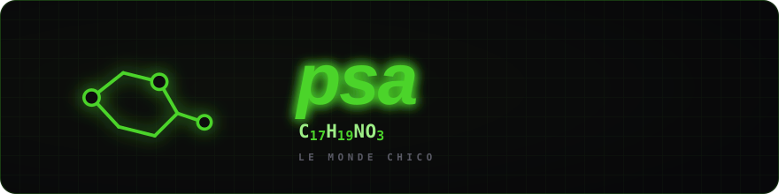
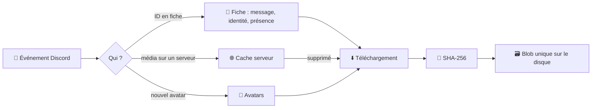

<p align="center">
  
</p>

<p align="center">
  
  
  
  
</p>

**psa** est un plugin **BetterDiscord** qui tient un registre privé des comptes Discord qui t'intéressent : une
**fiche** par ID, avec ses médias, tes notes, ses anciens pseudos et avatars, ses messages supprimés ou édités et
sa présence. Il garde aussi les images et vidéos supprimées sur tes serveurs, archive les photos de profil que tu
croises et range tes propres comptes dans un **coffre chiffré**.

> [!NOTE]
> **Tout reste sur ta machine**, dans `%AppData%\BetterDiscord\data\psa\`. Pas de bot, pas de serveur, rien n'est
> envoyé ailleurs. Le plugin ne voit que ce que ton compte reçoit déjà.

> [!WARNING]
> Les client mods (BetterDiscord, Vencord…) sont contraires aux conditions d'utilisation de Discord.
> À utiliser sur ton compte, à tes risques.

## Sommaire

| | |
|---|---|
| 🚀 [Installer](#-installer) | le plugin, l'icône, ffmpeg en option |
| 🧭 [Le dashboard](#-le-dashboard) | ouvrir psa et s'y retrouver |
| 📇 [Les fiches](#-les-fiches) | clic droit, onglet de profil, ce que contient une fiche |
| 📡 [Le logger](#-le-logger) | messages supprimés ou édités, identité, présence |
| 🌐 [Serveurs](#-serveurs) | les images et vidéos supprimées de tes serveurs |
| 👤 [Avatars](#-avatars) | les photos de profil croisées |
| 🔐 [Comptes](#-comptes) | le coffre chiffré de tes comptes |
| 💾 [Réglages et sauvegardes](#-réglages-et-sauvegardes) | interrupteurs, backup, exports |
| 🧠 [Sous le capot](#-sous-le-capot) | stockage, dédoublonnage, chiffrement |
| 📁 [Fichiers](#-fichiers) | ce qu'il y a dans le dépôt |

---

## 🚀 Installer

1. Installe [BetterDiscord](https://betterdiscord.app).
2. Copie **`psa.plugin.js`** dans le dossier des plugins : `%AppData%\BetterDiscord\plugins\`
   (dans Discord : **Paramètres → Plugins → Ouvrir le dossier des plugins**).
3. Active **psa** dans **Paramètres → Plugins**. Le dossier `%AppData%\BetterDiscord\data\psa\` se crée tout seul.
4. Pour l'icône du lanceur, copie **`icon.png`** dans ce dossier `data\psa\`. Sans elle, le bouton affiche 🐫.

Pas de build : un seul fichier. Tu le modifies, BetterDiscord le recharge.

**Optionnel : ffmpeg.** Certaines vidéos, comme les `.mov`, ne se lisent pas dans Discord. Si ffmpeg est installé,
psa les convertit en `.mp4` tout seul. Il le cherche dans le `PATH` et dans les paquets WinGet :

```bash
winget install Gyan.FFmpeg
```

---

## 🧭 Le dashboard

Le bouton **psa** se pose à côté de la roue des paramètres, en bas à gauche de Discord. Au premier clic de la
session, le logo s'anime puis le dashboard s'ouvre ; un clic sur l'animation la passe.

| Section | Ce qu'elle montre |
|---|---|
| **Vue d'ensemble** | 6 compteurs (fiches, médias, notes, supprimés, édités, stockage) et les fiches récentes |
| **Fiches** | toutes les fiches, avec recherche par nom ou ID, tri et pagination |
| **Serveurs** | les médias supprimés captés sur tes serveurs |
| **Avatars** | la galerie des photos de profil archivées |
| **Comptes** | le coffre chiffré de tes comptes |
| **Réglages** | interrupteurs, sauvegardes, exports, diagnostics |

Le tableau des fiches donne pour chaque ID : nom, médias, notes, messages supprimés, messages édités, dernière
fois vu, statut, actions. Les compteurs et les listes se mettent à jour en direct, sans rouvrir le dashboard.

---

## 📇 Les fiches

Une fiche s'ouvre ou se remplit depuis un clic droit :

| Clic droit sur | Entrée | Effet |
|---|---|---|
| un utilisateur | **View fiche** | ouvre sa fiche |
| un utilisateur | **Add note** | ajoute une note à sa fiche |
| un utilisateur | **Dashboard** | ouvre le dashboard |
| un message avec images ou vidéos | **Save to fiche (N)** | télécharge les médias dans la fiche de l'auteur, sans doublon |
| un message | **View author fiche** | ouvre la fiche de l'auteur |

Le profil Discord d'un utilisateur gagne aussi un onglet **Fiche**, à côté d'Activité et Serveurs en commun.

| Partie de la fiche | Contenu |
|---|---|
| **Identité** | pseudos et noms affichés successifs, 20 derniers avatars, âge du compte |
| **Médias** | galerie paginée, 24 par page, avec le filtre **≈ Similaires** |
| **Messages** | messages supprimés et édités, 20 par page |
| **Présence** | statut, jeux joués, Spotify, statut personnalisé |
| **Notes** | tes notes, ajoutées depuis la fiche ou par clic droit |

---

## 📡 Le logger

Pour chaque ID qui a une fiche, psa note en direct :

- les **messages supprimés** et **édités**, avec l'ancien texte et les médias téléchargés ;
- les changements de **pseudo**, de **nom affiché** et d'**avatar** ;
- la **présence** : statut, jeu en cours, Spotify, statut personnalisé.

Un toast prévient quand une cible supprime ou édite un message. Tout est côté client : psa ne voit que ce que ton
compte reçoit déjà.

---

## 🌐 Serveurs

Sur tous tes serveurs, psa garde les **images et vidéos supprimées**. Les suppressions de texte seul, les bots et
les webhooks sont ignorés.

- Une carte par serveur : icône, nombre de salons, nombre de médias supprimés.
- Dans un serveur : une galerie avec les filtres **Tous / 🖼 Images / 🎬 Vidéos**, une recherche, et une
  visionneuse plein écran avec ‹ › pour passer d'un média à l'autre.
- Chaque média indique l'auteur, le salon et l'heure. Tu peux en supprimer un, ou **🗑 Vider** tout le serveur.

Un même fichier n'est jamais gardé deux fois. Un serveur garde ses 600 dernières suppressions.

---

## 👤 Avatars

psa archive les **photos de profil** des gens que tu croises : auteurs de messages et mises à jour de profil.

- Image brute, pas recadrée en rond. Les avatars animés gardent leur gif, avec un badge **gif**.
- Recherche, tri **Récent / A–Z**, visionneuse plein écran.
- Un avatar déjà archivé n'est pas repris, même s'il revient sous un autre lien. Jusqu'à 5 000 avatars.

---

## 🔐 Comptes

Un coffre pour **tes propres comptes** Discord, verrouillé par une phrase secrète.

1. À la première ouverture de **Comptes**, choisis une phrase secrète. Elle chiffre les tokens ;
   **oubliée, rien ne se récupère**.
2. Colle un ou plusieurs tokens puis **＋ Ajouter** : psa signale ceux déjà présents et ceux invalides.
3. **Basculer** sur un compte : Discord se recharge directement dessus.
4. **🔄 Vérifier les tokens** teste chaque compte :

| État | Ce que ça veut dire | Quoi faire |
|---|---|---|
| **actif** | le token marche | rien |
| **verrouillé** | le token marche, mais Discord demande une vérification | bouton jaune **GUIDE** : les étapes officielles pour déverrouiller |
| **banni** | Discord a désactivé le compte | bouton jaune **GUIDE** : le formulaire d'appel officiel |
| **mort** | token invalide, après une déconnexion ou un changement de mot de passe | **Retirer les morts** |

<details>
<summary><b>Le coffre en détail</b></summary>
<br>

| | |
|---|---|
| Chiffrement | AES-256-GCM, avec la WebCrypto du client Discord |
| Clé | dérivée de la phrase secrète par PBKDF2-SHA-256, 210 000 itérations, sel aléatoire |
| Fichier | `%AppData%\BetterDiscord\data\psa.sec\vault.json`, écrit de façon atomique |
| En mémoire | la clé et les comptes déchiffrés, le temps de la session seulement |
| Bascule | token écrit dans le `localStorage` puis rechargement ; en secours `loginToken`, puis `setToken` |
| Vérification | `GET /users/@me` : compte désactivé (code 20026), vérification requise (code 40002), token refusé (401) |

L'ancien plugin séparé `psa.sec` est fusionné dans psa : même coffre, même fichier.

</details>

---

## 💾 Réglages et sauvegardes

| Interrupteur | Par défaut | Rôle |
|---|---|---|
| **Logger complet** | oui | messages, identité et présence des IDs en fiche |
| **Toast en direct** | oui | une notification quand une cible supprime ou édite |
| **Serveurs : médias supprimés** | oui | la capture de la section Serveurs |
| **Pfp : photos de profil** | oui | la capture de la section Avatars |
| **Intro à l'ouverture** | oui | l'animation du logo au premier clic |

| Bouton | Effet |
|---|---|
| **💾 Créer un backup** | sauvegarde complète, fiches et médias, dans `backups/psa-backup-<date>.json` |
| **↺ Restaurer (dernier)** | fusionne le dernier backup dans ton registre actuel |
| **📁 Dossier backups** | ouvre le dossier des sauvegardes |
| **📝 Pseudos (.txt)** | la liste des pseudos suivis dans `psa-usernames.txt` |
| **🖼 Scrap pfp (.jpg)** | une copie des avatars archivés, en `.jpg`, dans `pfp-export/` |
| **⧉ Dump layout**, **⧉ Dump Discord** | écrivent la mise en page du plugin et de Discord dans `psa-dbg-*.txt`, pour déboguer |

---

## 🧠 Sous le capot



<details>
<summary><b>🗃️ Stockage</b> : JSON pour les infos, blobs pour les fichiers</summary>
<br>

```
%AppData%\BetterDiscord\data\
├── psa\
│   ├── fiches\<userId>\fiche.json     une fiche : identité, notes, médias, messages, présence
│   ├── servers\<guildId>\server.json  les suppressions d'un serveur
│   ├── pfp\pfp.json                   l'index des avatars
│   ├── blobs\<xx>\<sha256>.<ext>      les fichiers, un seul exemplaire chacun
│   ├── blobs\index.json               l'index des blobs
│   ├── backups\                       les sauvegardes
│   └── icon.png                       l'icône du lanceur
└── psa.sec\vault.json                 le coffre chiffré
```

Les fichiers sont écrits sur le disque, pas en base64 dans le JSON : ils survivent à l'expiration des liens du CDN
de Discord. Si un téléchargement échoue, seul le lien est gardé, marqué ⚠. Limite : 24 Mo par fichier.

</details>

<details>
<summary><b>🔑 Dédoublonnage</b> : SHA-256 exact, dHash pour les images proches</summary>
<br>

- **Exact** : chaque fichier est rangé sous son **SHA-256**. Un même fichier n'existe qu'une fois sur le disque,
  partagé entre fiches, serveurs et avatars.
- **Images proches** : un **dHash** est calculé pour chaque image. Les copies redimensionnées ou recompressées
  portent un badge `≈N` et sortent avec le filtre **≈ Similaires**. Rien n'est supprimé tout seul : tu choisis.
- **Ménage** : supprimer un média ou une fiche retire juste la référence. Un passage de fond efface ensuite les
  blobs que plus rien ne cite, sans compteur de références qui pourrait dériver.

</details>

<details>
<summary><b>⬇️ Téléchargement et affichage</b> : sans CORS, sans base64</summary>
<br>

- Le `fetch` du client est bloqué par CORS sur `cdn.discordapp.com`. psa passe par `BdApi.Net.fetch`, puis par le
  module `https` de Node, qui suit les redirections.
- L'affichage lit le fichier et en fait une URL `blob:` en mémoire, libérée au changement de page : pas de base64
  qui gonfle la mémoire.
- Les vidéos que Chromium ne lit pas sont converties en `.mp4` par ffmpeg s'il est là. Sinon, une carte propose
  **▶ Ouvrir dans le lecteur** ou **📁 Voir le fichier**.

</details>

<details>
<summary><b>📡 Écoute</b> : le dispatcher de Discord</summary>
<br>

psa s'abonne aux événements `MESSAGE_CREATE`, `MESSAGE_UPDATE`, `MESSAGE_DELETE`, `MESSAGE_DELETE_BULK`,
`USER_UPDATE`, `GUILD_MEMBER_UPDATE` et `PRESENCE_UPDATE`.

Un message supprimé n'est plus lisible quand l'événement arrive : psa garde en mémoire les messages récents, dont
les 6 000 derniers qui contiennent un média sur un serveur, et retrouve le contenu au moment de la suppression.

</details>

<details>
<summary><b>🔄 Migration</b> : depuis les anciennes versions</summary>
<br>

Au premier lancement après une mise à jour, les anciens dossiers de médias sont déplacés dans le magasin de blobs.
Les fiches sont d'abord copiées dans `backups/pre-blob-*`. La migration peut être relancée sans risque et ne
supprime jamais un fichier unique.

</details>

---

## 📁 Fichiers

| Fichier | Rôle |
|---|---|
| [`psa.plugin.js`](psa.plugin.js) | le plugin, tout en un : fiches, logger, serveurs, avatars, coffre, dashboard |
| [`icon.png`](icon.png) | l'icône du lanceur, à copier dans `data\psa\` |
| [`docs/banner.svg`](docs/banner.svg) | la bannière |

Tes fiches, tes médias et ton coffre restent dans `%AppData%\BetterDiscord\data\` et ne font pas partie du dépôt.

---

<p align="center">
  <sub>Du même auteur : <a href="https://github.com/ninoelhaj/crochetage"><b>Crochetage</b></a> · <a href="https://github.com/ninoelhaj/paperasse"><b>Paperasse</b></a> · <a href="https://github.com/ninoelhaj">profil</a></sub>
</p>
